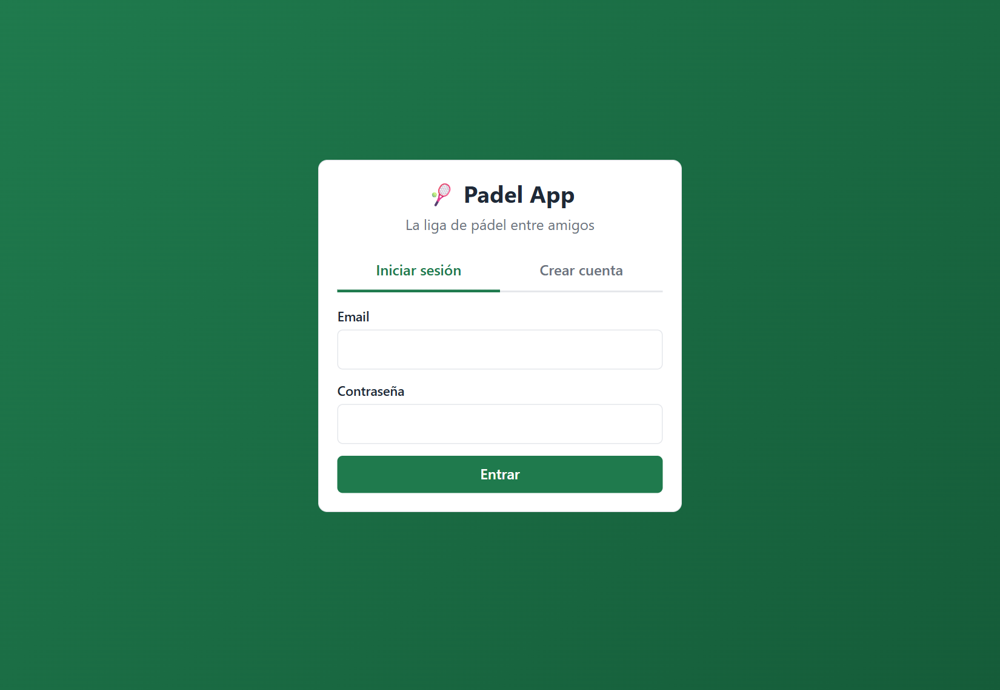
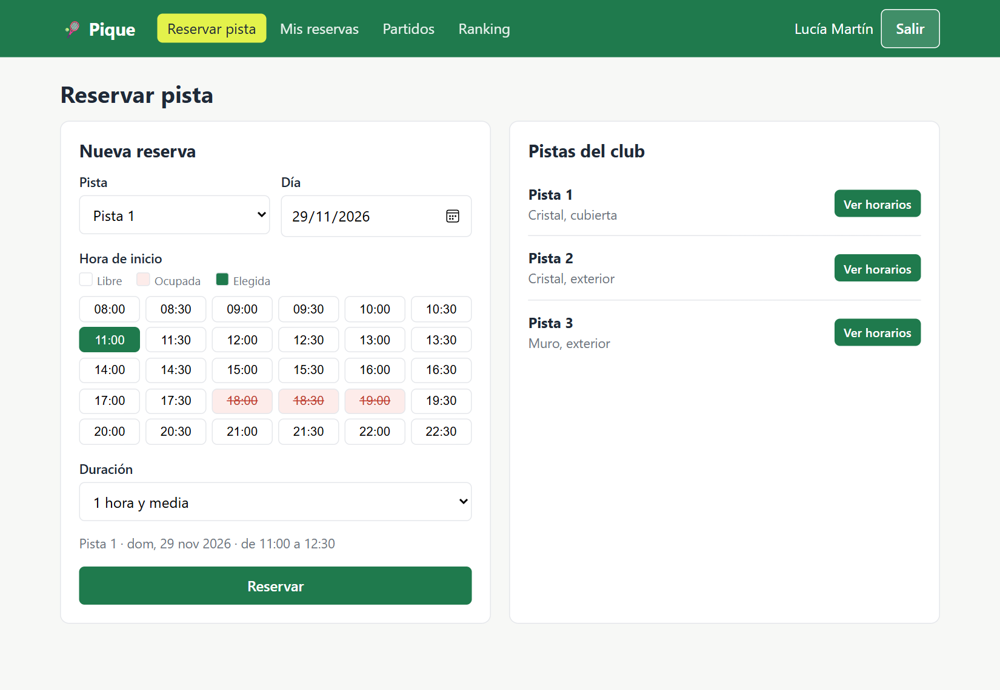
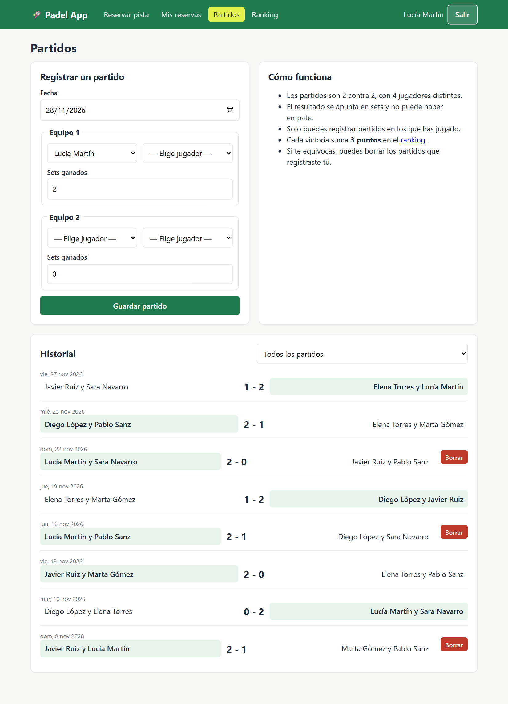
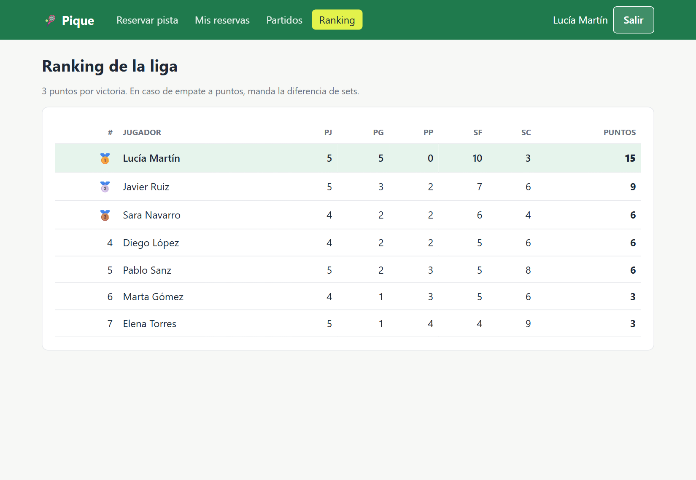
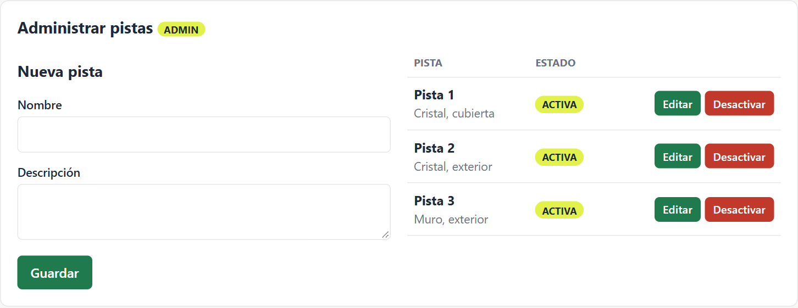

# Pique — Informe técnico

**Asignatura:** Programación en servidores web · 4.º de Ingeniería Informática · CUNEF Universidad
**Grupo:** Guillermo Taffouraud · Oriol García Miró · Rodrigo González
**Repositorio:** https://github.com/guilletaff/Pique
**Fecha:** 1 de diciembre de 2026

---

## 1. Descripción del sistema

Pique es una aplicación web para organizar una liga de pádel entre amigos. La idea surge de una liga real que organiza uno de los miembros del grupo, en la que hasta ahora las reservas, los resultados y la clasificación se llevaban a mano en un grupo de mensajería y una hoja de cálculo.

La aplicación resuelve tres necesidades:

1. **Reservar pistas** sin que dos personas reserven la misma pista a la misma hora.
2. **Apuntar los resultados** de los partidos (siempre 2 contra 2).
3. **Consultar un ranking** que se calcula solo a partir de esos resultados.

### Tipos de usuario

| Funcionalidad | Jugador | Administrador |
|---|:---:|:---:|
| Registrarse, iniciar y cerrar sesión | ✔ | ✔ |
| Ver las pistas y su disponibilidad por día | ✔ | ✔ |
| Reservar una pista en una franja horaria | ✔ | ✔ |
| Ver y cancelar sus propias reservas | ✔ | ✔ (también las de otros) |
| Registrar partidos y ver el historial | ✔ | ✔ |
| Ver el ranking | ✔ | ✔ |
| Crear, editar, desactivar y reactivar pistas | | ✔ |

Todo el mundo se registra como **jugador**. El rol de **administrador** solo se puede asignar directamente en la base de datos, nunca desde la API.

### Reglas de negocio

- Dos reservas de la misma pista no pueden solaparse en el tiempo.
- Una reserva no puede estar en el pasado ni durar más de 3 horas, y solo se pueden reservar pistas activas.
- Un jugador solo puede cancelar sus propias reservas (el administrador, cualquiera).
- Una pista no se borra: se desactiva, para no perder el historial de reservas.
- Un partido es de 2 contra 2: 4 jugadores distintos, repartidos en dos equipos, con un resultado en sets sin empate y en una fecha que no sea futura.
- Un jugador solo puede registrar partidos en los que ha jugado; solo quien lo registró (o un administrador) puede borrarlo.
- El ranking da 3 puntos por victoria; los empates a puntos se deshacen por diferencia de sets.

### Capturas











## 2. Arquitectura

### Visión general

```
 Navegador (HTML + CSS + JS)
        │  fetch('/api/...')  ·  cabecera Authorization: Bearer <JWT>
        ▼
 ┌───────────────── contenedor "app" (Node.js 22) ─────────────────┐
 │ Express                                                          │
 │  helmet → express.json → archivos estáticos → /api-docs (Swagger)│
 │  routes  →  middlewares (verificarToken, requiereRol)            │
 │          →  controllers (validación y reglas de negocio)         │
 │          →  models (consultas SQL parametrizadas, librería pg)   │
 └──────────────────────────────┬───────────────────────────────────┘
                                │  TCP 5432 (red interna de Docker)
 ┌──────────────────────────────▼───────────────────────────────────┐
 │ contenedor "db" (PostgreSQL 16) · volumen pgdata · db/init.sql   │
 └──────────────────────────────────────────────────────────────────┘
```

El mismo servidor Express sirve la API (`/api/...`) y el frontend (carpeta `src/public`), así que el navegador y la API comparten origen y no hace falta CORS. Al iniciar sesión, la API devuelve un JWT en el JSON de la respuesta; el frontend lo guarda en `sessionStorage` y lo envía en la cabecera `Authorization: Bearer <token>` de cada petición, tal y como se vio en clase (autenticación basada en tokens).

### Backend: patrón MVC

| Capa | Carpeta | Responsabilidad |
|---|---|---|
| Rutas | `src/routes` | Asocian cada método y URL a un controlador y aplican los middlewares de acceso |
| Middlewares | `src/middlewares` | `verificarToken` (hay sesión válida) y `requiereRol('admin')` |
| Controladores | `src/controllers` | Validan los datos de entrada, aplican las reglas de negocio y deciden el código HTTP |
| Modelos | `src/models` | Solo consultas SQL; no saben nada de HTTP |
| Configuración | `src/config/db.js` | Pool de conexiones a PostgreSQL |

Módulos: `auth`, `usuarios`, `pistas`, `reservas`, `partidos` y `ranking`. Todos siguen el mismo patrón (`x.routes.js`, `x.controller.js`, `x.model.js`) y se montan en `src/app.js`.

Las respuestas siempre son JSON y los errores tienen la forma `{ "error": "mensaje" }` con el código adecuado (400, 401, 403, 404, 409, 413 o 500).

### Documentación de la API

La API está descrita con **OpenAPI 3** en `docs/openapi.yaml` (rutas, parámetros, cuerpos, respuestas, esquemas reutilizables con `$ref` y el esquema de seguridad `bearerAuth`). El propio servidor la sirve con **Swagger UI** (`swagger-ui-express` + `yamljs`) en http://localhost:3000/api-docs, donde se pueden probar los endpoints pegando el token en «Authorize». Además, `docs/API.md` resume la API con ejemplos.

### Frontend

HTML, CSS y JavaScript sin frameworks. Hay una página por sección (`index.html`, `pistas.html`, `reservas.html`, `partidos.html`, `ranking.html`) y un archivo `js/comun.js` con lo compartido:

- `api()`: envuelve `fetch`, añade la cabecera `Authorization: Bearer` con el token guardado en `sessionStorage`, envía y recibe JSON y convierte los errores de la API en excepciones con el mensaje del servidor.
- `iniciarPagina()`: comprueba la sesión con `/api/auth/me`, redirige al login si no la hay y pinta la barra de navegación.
- `el()`: crea elementos del DOM poniendo los textos con `textContent`, lo que evita el XSS.

Las opciones de administración solo se muestran al rol `admin`, pero esto es solo comodidad visual: la seguridad real está en la API.

### Tecnologías

| Parte | Tecnología |
|---|---|
| Servidor | Node.js 22, Express 4 |
| Base de datos | PostgreSQL 16, librería `pg` |
| Autenticación | `jsonwebtoken`, `bcrypt` |
| Seguridad | `helmet` |
| Documentación de la API | OpenAPI 3, `swagger-ui-express`, `yamljs` |
| Frontend | HTML5, CSS3, JavaScript (ES2020) |
| Despliegue | Docker, Docker Compose |
| Control de versiones | Git y GitHub (ramas `feature/...` y Pull Requests revisadas) |

## 3. Base de datos

Se eligió una base de datos **relacional (PostgreSQL)** porque los datos están muy relacionados (usuarios, pistas, reservas, partidos) y porque permite garantizar reglas de negocio con restricciones en la propia base de datos (`CHECK`, `UNIQUE`, claves foráneas) y agrupar operaciones en transacciones.

El esquema está en `db/init.sql` y Docker lo carga automáticamente la primera vez que arranca el contenedor.

### Modelo entidad-relación

```
 usuarios ──1───N── reservas ──N───1── pistas
    │
    ├──1───N── partidos (creado_por)
    │              │
    └──1───N── partido_jugadores ──N───1── partidos
```

### Tablas

**usuarios**

| Columna | Tipo | Restricciones |
|---|---|---|
| id | SERIAL | PK |
| nombre | VARCHAR(80) | NOT NULL |
| email | VARCHAR(120) | NOT NULL, UNIQUE |
| password_hash | VARCHAR(255) | NOT NULL (hash bcrypt) |
| rol | VARCHAR(10) | NOT NULL, por defecto `jugador`, CHECK en (`jugador`, `admin`) |
| creado_en | TIMESTAMPTZ | por defecto NOW() |

**pistas**

| Columna | Tipo | Restricciones |
|---|---|---|
| id | SERIAL | PK |
| nombre | VARCHAR(60) | NOT NULL, UNIQUE |
| descripcion | TEXT | |
| activa | BOOLEAN | NOT NULL, por defecto TRUE |

**reservas**

| Columna | Tipo | Restricciones |
|---|---|---|
| id | SERIAL | PK |
| usuario_id | INTEGER | FK → usuarios |
| pista_id | INTEGER | FK → pistas |
| inicio, fin | TIMESTAMPTZ | NOT NULL, CHECK (fin > inicio) |

**Reservas sin solapes.** Antes de insertar una reserva, la API comprueba con una consulta parametrizada si ya hay alguna reserva de esa pista que se solape con la franja pedida (dos franjas se solapan si una empieza antes de que acabe la otra y viceversa: `inicio < fin_nuevo AND fin > inicio_nuevo`). Si la hay, responde `409 Conflict`; las franjas contiguas (por ejemplo, 17:00–18:30 y 18:30–20:00) sí se permiten.

*Limitación conocida:* como la comprobación y la inserción son dos consultas separadas, dos peticiones exactamente simultáneas para la misma franja podrían colarse las dos. En una liga de amigos es muy improbable; como mejora futura se podría resolver con una restricción en la propia base de datos.

**partidos**

| Columna | Tipo | Restricciones |
|---|---|---|
| id | SERIAL | PK |
| fecha | DATE | por defecto CURRENT_DATE |
| creado_por | INTEGER | FK → usuarios |
| sets_equipo1, sets_equipo2 | SMALLINT | ≥ 0, CHECK (sets_equipo1 <> sets_equipo2): sin empates |

**partido_jugadores** (relación N:M entre partidos y usuarios)

| Columna | Tipo | Restricciones |
|---|---|---|
| partido_id | INTEGER | FK → partidos (ON DELETE CASCADE) |
| usuario_id | INTEGER | FK → usuarios |
| equipo | SMALLINT | CHECK en (1, 2) |
| | | PK (partido_id, usuario_id): un jugador no puede aparecer dos veces en el mismo partido |

Un partido y sus cuatro jugadores se insertan dentro de una **transacción** (`BEGIN` / `COMMIT` / `ROLLBACK`), de forma que nunca queda un partido a medias.

### Cálculo del ranking

El ranking no se guarda en ninguna tabla: se calcula en cada consulta con SQL (`JOIN` de `usuarios`, `partido_jugadores` y `partidos`, `COUNT ... FILTER` para las victorias y `SUM` para los sets). Así nunca puede quedar desactualizado. Para el tamaño de una liga de amigos el coste es despreciable.

## 4. Seguridad

| Riesgo | Medida aplicada |
|---|---|
| Robo de contraseñas | Se guardan cifradas con **bcrypt** (12 rondas, con sal). Nunca se devuelve `password_hash` en una respuesta. |
| Robo de sesión por XSS | El JWT se guarda en **`sessionStorage`** (se borra al cerrar la pestaña) y viaja en la cabecera **`Authorization: Bearer`**. Como un script malicioso podría leer `sessionStorage`, lo importante es que no se pueda inyectar ninguno: el frontend pinta los datos con `textContent` y la **CSP** de Helmet solo permite scripts del propio servidor. |
| CSRF | El token **no va en una cookie**, así que el navegador no lo adjunta solo en peticiones que vienen de otras webs: una web ajena no puede actuar en nombre del usuario (comparativa cookies frente a tokens del tema 06). |
| Sesiones eternas | El JWT caduca a las **2 horas**. |
| Escalada de privilegios | El rol no se acepta al registrarse; solo se cambia en la base de datos. Middleware `requiereRol('admin')` en las rutas de administración. |
| Acceso a datos ajenos | Comprobación de propietario: solo el dueño (o un admin) cancela una reserva o borra un partido; solo los jugadores de un partido pueden registrarlo. `/api/usuarios` y la disponibilidad de pistas no exponen emails ni quién reservó. |
| Inyección SQL | Todas las consultas son **parametrizadas** (`$1`, `$2`...), nunca se concatena texto del usuario. |
| Datos inválidos | **Validación** en cada controlador: tipos (por ejemplo, rechazar un número donde se espera texto), formatos (email, fechas ISO), longitudes y rangos. Además, restricciones `CHECK`, `UNIQUE` y claves foráneas en la base de datos. |
| XSS en el frontend | Los datos se pintan con `textContent`, nunca con `innerHTML`. **Helmet** añade una política **CSP** que solo permite scripts del propio servidor (ni scripts inline ni externos). Probado registrando un usuario con nombre `<b>...</b>`: se muestra como texto. |
| Enumeración de cuentas | Mismo mensaje de error en el login si falla el email o la contraseña, para no revelar qué cuentas existen. |
| Peticiones abusivas | Cuerpo JSON limitado a **10 kB** (`413`). |
| Fugas de información | Errores **genéricos** (`Error del servidor`) y manejador de errores propio: nunca se envían trazas. Helmet elimina la cabecera `X-Powered-By`. |
| Otras cabeceras | Helmet: `X-Content-Type-Options: nosniff`, `X-Frame-Options` (clickjacking), `Referrer-Policy`, y HSTS en producción. |
| Secretos | Claves en `.env`, que está en `.gitignore`; en el repositorio solo hay un `.env.example`. La app no arranca si falta `JWT_SECRET`. |
| Superficie de red | PostgreSQL solo publica su puerto en `127.0.0.1`. El contenedor de la app se ejecuta con el usuario sin privilegios `node` y solo instala dependencias de producción. |

## 5. Despliegue

La aplicación se despliega con **Docker Compose** y dos servicios:

- **db**: imagen oficial `postgres:16-alpine`. Los datos se guardan en el volumen `pgdata`, y `db/init.sql` se monta en `/docker-entrypoint-initdb.d/` para crear el esquema la primera vez. Tiene un `healthcheck` con `pg_isready`.
- **app**: imagen construida con el `Dockerfile` (`node:22-alpine`, `npm ci --omit=dev`, copia `src/` y `docs/openapi.yaml`, usuario `node`). Espera a que la base de datos esté sana (`depends_on: condition: service_healthy`) y lee la configuración del `.env`.

Puesta en marcha:

```
cp .env.example .env        # y cambiar las claves
docker compose up --build
docker compose exec app npm run seed   # opcional: datos de ejemplo
```

Las instrucciones completas están en el `README.md`.

## 6. Pruebas

Se probó la aplicación de extremo a extremo contra una base de datos PostgreSQL 16 real:

- **API**: todos los casos correctos y de error de cada endpoint (registro con datos de tipos incorrectos, login fallido, reservas solapadas, partidos con jugadores repetidos, empates, fechas futuras, jugadores inexistentes, acceso sin sesión, acceso de un jugador a acciones de otro o de administrador, JSON mal formado, peticiones demasiado grandes, rutas inexistentes).
- **Frontend**: recorrido completo en el navegador (registro, reserva, cancelación, registro de partido, ranking, cierre de sesión, redirección al login sin sesión, panel de administración) en tamaño de escritorio y de móvil, sin errores en la consola.

## 7. Organización del trabajo

- Repositorio en GitHub con `main` protegida: solo se fusiona mediante **Pull Request revisada** por otro miembro.
- Una rama por tarea (`feature/auth`, `feature/auth-limite`, `feature/reservas`, `feature/ranking`...) y commits pequeños con prefijo (`feat:`, `fix:`, `docs:`).

| Fase | Contenido |
|---|---|
| 0 | Preparación: repositorio, Docker y esqueleto MVC |
| 1 | Base de datos y autenticación |
| 2 | Pistas y reservas |
| 3 | Partidos y ranking |
| 4 | Frontend |
| 5 | Seguridad y documentación |
| 6 | Informe, presentación y entrega |

## 8. Conclusiones

Se ha construido una aplicación web completa que cubre todos los requisitos del enunciado: control de versiones con Git y GitHub, frontend con HTML, CSS y JavaScript, backend con Node.js y Express organizado en MVC, persistencia en PostgreSQL, autenticación y autorización por roles, medidas de seguridad web, despliegue con Docker y documentación de la API y de la instalación.

Lo más interesante del proyecto ha sido repartir bien las reglas de negocio entre la API y la base de datos. La base de datos garantiza lo básico (`CHECK` contra empates y franjas sin sentido, claves foráneas, transacciones al registrar un partido) y la API comprueba lo que depende de varias filas, como que dos reservas no se solapen. Hemos visto también el límite de esa comprobación ("mira si está libre y luego guarda") cuando llegan dos peticiones a la vez, y cómo se podría reforzar en el futuro.

También hemos visto que la seguridad no es un añadido del final, sino un conjunto de pequeñas decisiones en cada capa: JWT con caducidad en la cabecera `Authorization`, consultas parametrizadas, validación de tipos, autorización por rol y por propietario, CSP y un frontend que nunca inserta HTML con datos del usuario.

### Posibles mejoras

- Pruebas automáticas (por ejemplo, con Jest y Supertest) ejecutadas en GitHub Actions en cada Pull Request.
- Confirmación de resultados por parte del equipo rival antes de que cuenten para el ranking.
- Temporadas o jornadas, para reiniciar el ranking periódicamente.
- Recuperación de contraseña por email y avisos de reserva.
- Despliegue en la nube con HTTPS (por ejemplo, detrás de un proxy inverso).
- Impedir también en la base de datos las reservas solapadas, para cubrir el caso de dos peticiones exactamente simultáneas.
